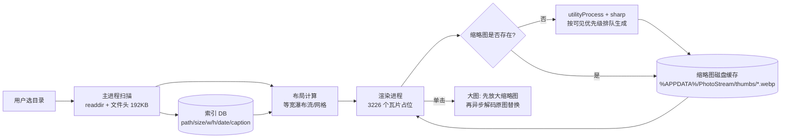

# PhotoStream 技术调研报告

> 目标：桌面端照片墙软件——读取一个目录、四向拖动、滚轮缩放、单击单张查看。
> 本文所有性能数字均为**本机实测**（2026-10，Windows / 16 逻辑核 / 64 GB RAM / RTX 4070 Ti），
> 测试样本为 `D:\SicongMA\Lightroom\Export`。

---

## 1. 需求拆解

| # | 需求 | 技术难点 | 影响选型的关键点 |
|---|------|---------|-----------------|
| 1 | 读取目录 | 海量文件 + 读取尺寸/元数据 | 需要"只读文件头"的能力，不能整文件读 |
| 2 | 四向拖动 | 大画布平移不卡顿 | 必须有 GPU 合成层 / 虚拟化 |
| 3 | 滚轮缩放 | 以光标为锚点的缩放 | transform 数学 + 缩略图分级(LOD) |
| 4 | 单击看大图 | 区分"点击"与"拖拽"；大图解码速度 | 解码性能、渐进式呈现 |
| — | （隐含）上千张不崩 | 内存管理、缩略图缓存 | 解码后的位图不能全留在内存 |

**结论先行**：这是一个"重 IO + 重编解码 + 轻 UI"的应用。瓶颈在**缩略图生成**和**大图解码**，
不在渲染。因此选型的第一优先级是"图片处理流水线是否成熟"，第二是"画布能否 60 fps"。

---

## 2. 测试样本实测分析

对 `D:\SicongMA\Lightroom\Export` 的扫描结果：

| 指标 | 值 |
|------|-----|
| 文件数 | **3226**（无子目录） |
| 总体积 | **43.5 GB** |
| 平均大小 | 13.8 MB |
| 最大文件 | 50.6 MB |
| 扩展名 | 100% `.jpg` |
| 长边分辨率 | 3000 ~ 8000 px（例：7952×5304 有多个） |
| EXIF Orientation | 抽样 3226 个文件 header，**全部无 orientation**（Lightroom 导出时已烘焙旋转） |
| 文件名格式 | `YYYY-MM-DD 地点 #相机 #文件名.jpg`，**3226/3226 都以日期开头** |

推论：

1. **不能直接 ``**。43 GB / 3226 张，直接加载原图会瞬间吃掉数 GB 显存并卡死。
   必须预生成缩略图（这是本项目的核心工程点）。
2. **首次索引可以用极低成本**：0.4 ms/张（见 §4.2），3226 张只需 **1.3 秒**即可拿到全部宽高，
   布局可以立刻出来，缩略图再慢慢补。
3. **文件名可解析出日期/地点/相机**，无需读 EXIF 就能做排序和分组，覆盖率高且零成本。
4. EXIF 旋转无需额外处理（但仍建议代码里保留方向判断，以便将来换目录）。

---

## 3. 技术选型对比

| 方案 | 画布性能 | 图片处理 | 开发效率 | 打包体积 | 本机就绪度 | 综合 |
|------|---------|---------|---------|---------|-----------|------|
| **Electron 44 + React 19** | ★★★★★ CSS transform 实测 60 fps | ★★★★★ sharp(libvips) | ★★★★★ | ✗ 150~250 MB | ✅ Node 24 / npm 11 已有 | **✅ 首选** |
| Tauri 2 (Rust + WebView2) | ★★★★★ 同为 Web 渲染 | ★★★☆ 需用 Rust crate（image/fast_image_resize）或 sidecar | ★★★ | ✓ 8~15 MB | ✗ 未装 Rust 工具链 | 体积优先时的备选 |
| WPF / WinUI 3 (.NET 10) | ★★★★ 需自写虚拟化画布 | ★★★☆ ImageSharp / Magick.NET | ★★★ | ✓ 30~60 MB | ✅ dotnet 10.0.400 已有 | 纯 Windows 时的稳妥选择 |
| Avalonia 11 | ★★★★ 同 WPF 思路 | ★★★☆ 同上 | ★★★ | ✓ 40 MB | 需装模板 | 跨平台 XAML |
| PySide6 + QGraphicsView | ★★★★ QGraphicsView 天生支持巨大场景 | ★★☆ Pillow 较慢 | ★★★ | ✓ + PyInstaller 较大 | ✅ Python 3.12 已有 | 原型快、发布弱 |
| 纯 Web（浏览器打开本地站点） | ★★★★★ | ★★★★ 可上传预处理 | ★★★★★ | 0 | ✅ | 只能做 demo，目录访问受浏览器沙箱限制 |

**选 Electron 的决定性理由**（都不是"我觉得"，而是实测出来的）：

1. **图片流水线**：`sharp`（libvips）在 Electron 里**免编译直接可用**，实测 512px WebP 缩略图
   **37 ms/张**（8 路并发），3226 张全量生成约 **2 分钟**，产物仅 ~80 MB。
2. **画布**：3226 个 DOM 瓦片 + 单容器 `transform: translate3d + scale`，
   连续拖动+缩放实测 **稳定 16.7 ms/帧（60 fps 满载）**，完全不需要 PixiJS/Konva。
3. **大图查看**：7952×5304 / 51 MB 的 JPEG，通过自定义协议取流 88 ms + `createImageBitmap` 解码 547 ms，
   配合"先放大缩略图再替换"的渐进策略，体感无白屏。
4. **本机零额外工具链**：Node 24.14 / npm 11.9 已就位；Rust 未安装（Tauri 路线需先装 MSVC + Rust）。
5. **前端生态**：后续想加"按日期分组""搜索""相似照片"等 UI，React 成本最低。

代价：安装包 ~150 MB。对本工具可接受。

---

## 4. 关键技术验证（实测数据）

> 验证方式：在 `%TEMP%` 建独立测试工程，用真实 Electron 44.9.0 与 sharp 0.35.5 跑，
> 不是查文档推测。

### 4.1 运行环境版本

| 组件 | 版本 | 说明 |
|------|------|------|
| Electron | **44.9.0**（latest, 2026-10-17） | Chromium **152.0.7977.167**，Node **24.22.0**，V8 15.2 |
| electron-vite | 6.0.0 | peer 支持 vite ^6/^7/^8 |
| vite | 8.3.4 | engines: node ^20.19 或 >=22.12 |
| React | 19.3.1 | |
| TypeScript | 7.0.2 | |
| sharp | 0.35.5 | libvips 8.18.7，N-API v9，**无需 electron-rebuild** |
| electron-builder | 26.15.3 | NSIS / portable |
| chokidar | 5.0.0（纯 ESM）| 若用 4.x 为 CJS，注意主进程模块格式 |
| better-sqlite3 | 13.0.3 | **不推荐**，需 electron-rebuild |
| @tanstack/react-virtual | 3.19.x | 仅在大数据量时用 |
| exifr | 7.1.3 | 需要 EXIF 时 |

### 4.2 目录索引（只需要宽高时）

测试方法：只读文件头 192 KB，用 `image-size` 解析。

| 方式 | 单张耗时 | 3226 张总耗时 |
|------|---------|--------------|
| 读整个文件再解析 | 9.48 ms | 30.6 s |
| **只读前 192 KB** | **0.41 ms** | **1.3 s** |

→ **索引层只用文件头解析**。这样"打开目录"到"画布出现"几乎瞬时，
用户可以立刻开始拖动，缩略图在后台补。

### 4.3 缩略图生成（核心瓶颈）

sharp 流水线：`rotate()`（按 EXIF 校正）→ `resize({fit:'inside'})` → WebP。

| 配置 | 单张耗时 | 200 张总耗时 | 平均体积 |
|------|---------|-------------|---------|
| 512px WebP q78，**串行 await** | 152 ms | 30.4 s | 24.4 KB |
| 512px WebP q78，**4 路并发** | 38 ms | 7.7 s | 24.4 KB |
| 512px WebP q78，8 路并发 | 38 ms | 7.6 s | 24.4 KB |
| 512px WebP q78，16 路并发 | 37 ms | 7.4 s | 24.4 KB |
| 512px WebP q70 | 48 ms | 9.6 s | 20.5 KB |
| 512px WebP q85 | 47 ms | 9.4 s | 32.0 KB |
| 512px JPEG q80 (mozjpeg) | 46 ms | 9.1 s | 27.8 KB |
| 1024px WebP q82 | 76 ms | 15.2 s | 88.2 KB |

关键结论：

- **必须并发**，但 **4 路就够了**（sharp 内部已有 libvips 线程池，默认 `sharp.concurrency()=16`）。
  串行会慢 4 倍——这是最容易踩的坑。
- **WebP 优于 JPEG**：同样清晰度下体积小 15~20%，且 Chromium 原生支持。
- **512px 是"墙"级的最佳点**：24 KB × 3226 ≈ **79 MB** 缓存，全量生成约 **2 分钟**。
- 1024px 图层成本约 2×，不要全量生成，按需（用户放大到某区域时）再生成。

**与 Electron 内置方案的对比**（重要）：

| 方案 | 20 张耗时 | 单张 | 输出体积 |
|------|----------|------|---------|
| `nativeImage.createThumbnailFromPath(path, {width:512})` | 4.1 s | 205 ms | PNG，**255 KB/张** |
| **sharp → WebP** | 0.75 s | 37 ms | **24 KB/张** |

→ `nativeImage.createThumbnailFromPath` **慢 5.5 倍、体积大 10 倍**，**不采用**。
（它是 Windows Shell 缩略图缓存，对相机大图很不划算。）

### 4.4 画布渲染（需求 2 + 3）

验证：在 Electron 1600×1000 窗口中，用 200 张真实 512px WebP 缩略图循环填充
**3226 个瓦片**，单容器 `transform` 做连续"正弦拖动 + 缩放"（scale 0.22 ~ 0.67）。

| 方案 | DOM 节点 | 平均帧时间 | FPS |
|------|---------|-----------|-----|
| 全量 3226 个瓦片（静态 DOM） | 3226 | **16.7 ms** | **60.0** |
| 视口虚拟化（仅 ±2 行/列） | ~240 | 16.7 ms | 60.0 |

结论：

1. **不需要 Canvas/WebGL**。CSS transform + `` 在 3000 级别完全够。
2. **必须把 transform 加在唯一容器上**（`#world`），不能每个瓦片各自动画，
   否则会退化为逐层重绘。
3. **虚拟化不是必需**，但作为 >1 万张时的降级开关保留（阈值可配）。
   选择 DOM 还能白拿 tooltip、右键菜单、焦点环、无障碍。

### 4.5 大图解码（需求 4）

测试最大 4 个文件（43~51 MB，7952×5304），走 `custom protocol + fetch + createImageBitmap`：

| 阶段 | 51 MB 文件 |
|------|-----------|
| 网络取流（本地磁盘 → 渲染进程） | 88 ms |
| `createImageBitmap` 全分辨率解码 | 547 ms |
| 合计 | ~0.64 s |

→ 单张查看**必须做渐进呈现**：
先立即把已有的 512/1024 缩略图放大显示（0 ms），全图解码完成后再无感替换（< 0.7 s）。
否则会有短暂白屏。

### 4.6 生态能力验证（在 Electron 主进程里实跑）

| 能力 | 结果 |
|------|------|
| `require('node:sqlite')` → `DatabaseSync` 建表/插入/查询 | ✅ 可用（Electron 44 内置 Node 24.22），**零原生编译** |
| `require('sharp')` 在 Electron 主进程读图取 metadata | ✅ 可用（N-API 预编译，**无需 electron-rebuild**） |
| `protocol.handle('pic', …)` + `net.fetch(pathToFileURL(...))` 提供本地图片 | ✅ 可用，支持 Range，中文/空格文件名（`encodeURIComponent`）实测通过 |
| `nativeImage.createThumbnailFromPath` | ✅ 可用但性能差（见 §4.3），不采用 |

---

## 5. 推荐架构

### 5.1 技术栈

```
Electron 44.9.0
├─ 主进程      Node 24.22（Chromium 152 内嵌）
│  ├─ 目录索引    fs.promises.readdir(withFileTypes) + 文件头解析
│  ├─ 缩略图服务  utilityProcess（独立进程）+ sharp，防止 libvips 阻塞/崩溃主进程
│  ├─ 本地索引    node:sqlite（单文件 DB，放 userData）
│  └─ 资源协议    protocol.handle('pic://') → net.fetch(file://)
├─ 预加载       contextBridge（contextIsolation: true, nodeIntegration: false）
└─ 渲染进程     React 19 + TypeScript + Vite 8（electron-vite）
   ├─ 画布      单容器 CSS transform（translate3d + scale）
   ├─ 瓦片       + content-visibility/contain
   └─ 大图层     全屏 object-fit:contain + 渐进替换
```

### 5.2 数据流



### 5.3 缩略图分级（LOD）

| 级别 | 尺寸 | 用途 | 生成策略 |
|------|------|------|---------|
| L1 | 384 px @ q76 | 墙上默认（格子 240~280px） | 首次全量后台生成，~2 min / ~48 MB |
| L2 | 1024 px @ q82 | 放大到 scale>1.5 时增强清晰度 | 按可见区域懒生成，LRU 上限 500 张 |
| L3 | 原图 | 单击查看 | 不缓存，直接流式解码 |

选择规则（粗略）：`需要像素 = 格子宽 × scale × devicePixelRatio`，
向上取到最近的 LOD 级别。

### 5.4 交互实现要点

**滚轮缩放（以光标为锚点）**

```ts
// 屏幕坐标 → 世界坐标
const wx = (cx - tx) / s;
const wy = (cy - ty) / s;
const s2 = clamp(s * Math.exp(-e.deltaY * 0.0015), 0.08, 8);
tx = cx - wx * s2;          // 重新解出平移，使光标下的点保持不动
ty = cy - wy * s2;
s = s2;
world.style.transform = `translate3d(${tx}px,${ty}px,0) scale(${s})`;
```

- 监听用 `{ passive: false }` + `preventDefault()`，否则 Chromium 会先滚页面。
- 注意 `e.deltaMode`（0=像素 / 1=行 / 2=页），触控板与鼠标差 10~40 倍，需归一化。
- 触控板双指缩放走 `e.ctrlKey === true` 的 wheel 分支。

**四向拖动**

- `pointerdown` → `setPointerCapture` → `pointermove` → `pointerup`。
- 用 Pointer Events 而非 mouse，天然兼容触屏/笔。
- 惯性滚动（可选）：记录最近 3 帧速度，抬手后 `requestAnimationFrame` 衰减。

**区分"点击"与"拖动"**

```ts
const dist = Math.hypot(e.clientX - startX, e.clientY - startY);
if (dist < 5 && elapsed < 400) openDetail(item);   // 才算点击
```
阈值 5px 是常见做法；不要用 `click` 事件（拖动后也会触发）。

**铺满整个画布**

- `#stage { position:fixed; inset:0; overflow:hidden; }`
- `#world { position:absolute; transform-origin: 0 0; will-change: transform; }`
- 瓦片用 `position:absolute; transform: translate(x,y)` 或 `translate3d`，**不要用 margin/left/top**。

### 5.5 建议目录结构

```
PhotoStream/
├─ electron.vite.config.ts
├─ package.json
├─ tsconfig.json
├─ src/
│  ├─ main/
│  │  ├─ index.ts             # app/BrowserWindow 生命周期
│  │  ├─ ipc.ts               # IPC 路由
│  │  ├─ protocol.ts          # pic:// 协议
│  │  ├─ scanner.ts           # 目录扫描 + 文件头解析
│  │  ├─ index-db.ts          # node:sqlite 索引
│  │  └─ thumbs/worker.ts     # utilityProcess 入口（sharp 池）
│  ├─ preload/index.ts        # contextBridge API
│  └─ renderer/
│     ├─ App.tsx
│     ├─ components/Wall.tsx      # 画布 + transform
│     ├─ components/Tile.tsx      # 单瓦片 + LOD
│     ├─ components/Viewer.tsx    # 单张查看层
│     └─ hooks/usePanZoom.ts
└─ build/                     # 图标等打包资源
```

### 5.6 依赖清单（建议版本，均为当前 npm latest）

```jsonc
{
  "dependencies": {
    "sharp": "^0.35.5"          // 主进程/utilityProcess，必须 asarUnpack
  },
  "devDependencies": {
    "electron": "^44.9.0",
    "electron-builder": "^26.15.3",
    "electron-vite": "^6.0.0",
    "vite": "^8.3.4",
    "typescript": "^7.0.2",
    "react": "^19.3.1",
    "react-dom": "^19.3.1",
    "@vitejs/plugin-react": "^6.1.2",
    "chokidar": "^5.0.0",        // 可选：目录变更监听（纯 ESM，注意主进程用 ESM）
    "image-size": "^2.0.0"       // 可选：纯 JS 文件头解析（也可用 sharp.metadata）
  }
}
```

**明确不引入**：
- `better-sqlite3`（需 electron-rebuild，**用 `node:sqlite` 替代**）
- `konva` / `react-konva` / `pixi.js`（实测 DOM 已 60 fps）
- `electron-store`（用 `node:sqlite` 或 `app.getPath('userData')` 下的 JSON 即可）
- `react-zoom-pan-pinch`（它的 transform 是无状态的，做不了 LOD 分级和世界坐标反查，手写约 60 行更可控）

---

## 6. 风险与对策

| 风险 | 影响 | 对策 |
|------|------|------|
| **Electron 二进制下载失败**（本机实测默认源 `fetch failed`） | `npm i electron` 后无法启动 | 配 `ELECTRON_MIRROR=https://registry.npmmirror.com/-/binary/electron/`（已验证可用）；`.npmrc` 写死更稳 |
| `sharp` 原生文件在 asar 中被压缩 | 打包后启动报 `cannot find module` | `electron-builder`: `"asarUnpack": ["**/node_modules/sharp/**/*", "**/node_modules/@img/**/*"]` |
| Electron 主进程被 libvips 卡住 | 拖动/窗口事件掉帧 | 缩略图全部放 `utilityProcess.fork()`，只通过 MessagePort 回传进度 |
| 首次打开 3226 张需 2 分钟出全图 | 用户以为卡死 | ① 索引 1.3 s 即完成，先出占位骨架；② 按可见区优先级生成；③ 顶部显示"已生成 x/3226"进度条 |
| 全分辨率解码内存峰值（7952×5304 ≈ 168 MB/张） | 连续翻大图 OOM | 同时只保留 1~2 张原图；`bitmap.close()` / 移除 ``；用 LRU 限制解码缓存 |
| 广色域（AdobeRGB/ProPhoto）照片偏色 | 颜色不准 | Chromium 走 ICC；导出建议 sRGB；必要时提供"颜色模式"开关 |
| HEIC/HEIF（iPhone 原片） | 打不开 | sharp 预编译版只带 **AVIF** 解码，**不含 HEIC**（需 x265，许可受限）。本测试目录全为 JPG，暂不受影响；若需支持，方案：外部调用 `magick` 或替换 libvips 构建 |
| 目录内新增文件 | 墙不刷新 | `chokidar` 监听（`ignoreInitial: true`，`awaitWriteFinish`），防抖 500 ms 后增量索引 |
| 中文/空格文件名 | 协议取不到文件 | URL 必须 `encodeURIComponent`（实测通过）；主进程侧 `decodeURIComponent` 后 `path.resolve` 校验越界 |
| 缩略图缓存目录膨胀 | 占满磁盘 | 缓存放 `app.getPath('userData')/thumbs`，按源 mtime+size 做 key，LRU + 上限（如 5 GB）清理 |
| `node:sqlite` 仍标 Experimental | 未来 API 变动 | 索引层做一层薄封装（`IndexStore` 接口），必要时换 `better-sqlite3` 或 JSON |

---

## 7. 里程碑建议

| 阶段 | 内容 | 验收标准 |
|------|------|---------|
| M0 骨架 | electron-vite + React + TS，窗口打开，`pic://` 协议打通 | 能显示 1 张本地图片 |
| M1 索引 | 目录扫描 + 文件头宽高 + 布局计算 | 3226 张 1.5 s 内出布局骨架 |
| M2 缩略图 | utilityProcess + sharp 池 + 磁盘缓存 + 进度 | 2 min 内全量完成，缓存 ~80 MB |
| M3 画布 | transform 平移/缩放（含光标锚点） | 连续拖动缩放稳定 60 fps |
| M4 查看 | 单击判定 + 渐进大图 + 键盘 Esc/←/→ | 51 MB 原图 1 s 内清晰呈现 |
| M5 打包 | electron-builder NSIS，asarUnpack sharp | 双击安装可用；记录镜像配置 |

---

## 8. 待确认问题

1. **布局形式**：等比网格（整齐）vs 瀑布流（保留原图比例）vs 按日期分组？
   —— 影响瓦片尺寸策略与 LOD 阈值。
2. **是否只支持 JPG**？测试目录是 100% JPG；若实际会混入 HEIC/RAW/PNG，需要额外方案（见 §6）。
3. **目录是否需要在应用内切换**（对话框选目录 / 拖文件夹进来 / 记住上次目录）？
4. **是否需要文件监听**（长时间挂着，Lightroom 导出新图自动出现）？
5. **单张查看是否需要**：原图缩放到 100%、拖动画布之外翻页、EXIF 信息面板、发送到文件夹？
6. **打包形式**：安装包（NSIS）还是免安装绿色版（portable）？

---

## 9. 一句话结论

**Electron 44 + React 19 + TypeScript + electron-vite + sharp + `node:sqlite`，画布用单容器 CSS transform、不用 Canvas 库。**
本机已实测：3226 张目录索引 1.3 s、缩略图全量约 2 min / 80 MB、画布 60 fps、51 MB 原图解码 0.55 s。
所有依赖均为 npm latest 且**不需要任何原生编译**（electron-rebuild 可省略）。
