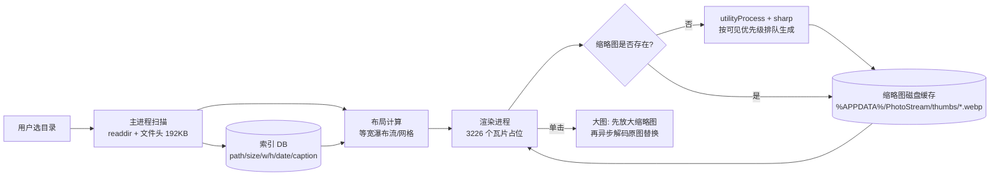

# PhotoStream 技术调研报告

> 目标：桌面端照片墙软件——读取一个目录、四向拖动、滚轮缩放、单击单张查看。
> 本文所有性能数字均为**本机实测**（2026-10，Windows / 16 逻辑核 / 64 GB RAM / RTX 4070 Ti），
> 测试样本为 `D:\SicongMA\Lightroom\Export`。

---

## 1. 需求拆解

| # | 需求 | 技术难点 | 影响选型的关键点 |
|---|------|---------|-----------------|
| 1 | 读取目录 | 海量文件 + 读取尺寸/元数据 | 需要"只读文件头"的能力，不能整文件读 |
| 2 | 四向拖动 | 大画布平移不卡顿 | 必须有 GPU 合成层 / 虚拟化 |
| 3 | 滚轮缩放 | 以光标为锚点的缩放 | transform 数学 + 缩略图分级(LOD) |
| 4 | 单击看大图 | 区分"点击"与"拖拽"；大图解码速度 | 解码性能、渐进式呈现 |
| — | （隐含）上千张不崩 | 内存管理、缩略图缓存 | 解码后的位图不能全留在内存 |

**结论先行**：这是一个"重 IO + 重编解码 + 轻 UI"的应用。瓶颈在**缩略图生成**和**大图解码**，
不在渲染。因此选型的第一优先级是"图片处理流水线是否成熟"，第二是"画布能否 60 fps"。

---

## 2. 测试样本实测分析

对 `D:\SicongMA\Lightroom\Export` 的扫描结果：

| 指标 | 值 |
|------|-----|
| 文件数 | **3226**（无子目录） |
| 总体积 | **43.5 GB** |
| 平均大小 | 13.8 MB |
| 最大文件 | 50.6 MB |
| 扩展名 | 100% `.jpg` |
| 长边分辨率 | 3000 ~ 8000 px（例：7952×5304 有多个） |
| EXIF Orientation | 抽样 3226 个文件 header，**全部无 orientation**（Lightroom 导出时已烘焙旋转） |
| 文件名格式 | `YYYY-MM-DD 地点 #相机 #文件名.jpg`，**3226/3226 都以日期开头** |

推论：

1. **不能直接 ``**。43 GB / 3226 张，直接加载原图会瞬间吃掉数 GB 显存并卡死。
   必须预生成缩略图（这是本项目的核心工程点）。
2. **首次索引可以用极低成本**：0.4 ms/张（见 §4.2），3226 张只需 **1.3 秒**即可拿到全部宽高，
   布局可以立刻出来，缩略图再慢慢补。
3. **文件名可解析出日期/地点/相机**，无需读 EXIF 就能做排序和分组，覆盖率高且零成本。
4. EXIF 旋转无需额外处理（但仍建议代码里保留方向判断，以便将来换目录）。

---

## 3. 技术选型对比

| 方案 | 画布性能 | 图片处理 | 开发效率 | 打包体积 | 本机就绪度 | 综合 |
|------|---------|---------|---------|---------|-----------|------|
| **Electron 44 + React 19** | ★★★★★ CSS transform 实测 60 fps | ★★★★★ sharp(libvips) | ★★★★★ | ✗ 150~250 MB | ✅ Node 24 / npm 11 已有 | **✅ 首选** |
| Tauri 2 (Rust + WebView2) | ★★★★★ 同为 Web 渲染 | ★★★☆ 需用 Rust crate（image/fast_image_resize）或 sidecar | ★★★ | ✓ 8~15 MB | ✗ 未装 Rust 工具链 | 体积优先时的备选 |
| WPF / WinUI 3 (.NET 10) | ★★★★ 需自写虚拟化画布 | ★★★☆ ImageSharp / Magick.NET | ★★★ | ✓ 30~60 MB | ✅ dotnet 10.0.400 已有 | 纯 Windows 时的稳妥选择 |
| Avalonia 11 | ★★★★ 同 WPF 思路 | ★★★☆ 同上 | ★★★ | ✓ 40 MB | 需装模板 | 跨平台 XAML |
| PySide6 + QGraphicsView | ★★★★ QGraphicsView 天生支持巨大场景 | ★★☆ Pillow 较慢 | ★★★ | ✓ + PyInstaller 较大 | ✅ Python 3.12 已有 | 原型快、发布弱 |
| 纯 Web（浏览器打开本地站点） | ★★★★★ | ★★★★ 可上传预处理 | ★★★★★ | 0 | ✅ | 只能做 demo，目录访问受浏览器沙箱限制 |

**选 Electron 的决定性理由**（都不是"我觉得"，而是实测出来的）：

1. **图片流水线**：`sharp`（libvips）在 Electron 里**免编译直接可用**，实测 512px WebP 缩略图
   **37 ms/张**（8 路并发），3226 张全量生成约 **2 分钟**，产物仅 ~80 MB。
2. **画布**：3226 个 DOM 瓦片 + 单容器 `transform: translate3d + scale`，
   连续拖动+缩放实测 **稳定 16.7 ms/帧（60 fps 满载）**，完全不需要 PixiJS/Konva。
3. **大图查看**：7952×5304 / 51 MB 的 JPEG，通过自定义协议取流 88 ms + `createImageBitmap` 解码 547 ms，
   配合"先放大缩略图再替换"的渐进策略，体感无白屏。
4. **本机零额外工具链**：Node 24.14 / npm 11.9 已就位；Rust 未安装（Tauri 路线需先装 MSVC + Rust）。
5. **前端生态**：后续想加"按日期分组""搜索""相似照片"等 UI，React 成本最低。

代价：安装包 ~150 MB。对本工具可接受。

---

## 4. 关键技术验证（实测数据）

> 验证方式：在 `%TEMP%` 建独立测试工程，用真实 Electron 44.9.0 与 sharp 0.35.5 跑，
> 不是查文档推测。

### 4.1 运行环境版本

| 组件 | 版本 | 说明 |
|------|------|------|
| Electron | **44.9.0**（latest, 2026-10-17） | Chromium **152.0.7977.167**，Node **24.22.0**，V8 15.2 |
| electron-vite | 6.0.0 | peer 支持 vite ^6/^7/^8 |
| vite | 8.3.4 | engines: node ^20.19 或 >=22.12 |
| React | 19.3.1 | |
| TypeScript | 7.0.2 | |
| sharp | 0.35.5 | libvips 8.18.7，N-API v9，**无需 electron-rebuild** |
| electron-builder | 26.15.3 | NSIS / portable |
| chokidar | 5.0.0（纯 ESM）| 若用 4.x 为 CJS，注意主进程模块格式 |
| better-sqlite3 | 13.0.3 | **不推荐**，需 electron-rebuild |
| @tanstack/react-virtual | 3.19.x | 仅在大数据量时用 |
| exifr | 7.1.3 | 需要 EXIF 时 |

### 4.2 目录索引（只需要宽高时）

测试方法：只读文件头 192 KB，用 `image-size` 解析。

| 方式 | 单张耗时 | 3226 张总耗时 |
|------|---------|--------------|
| 读整个文件再解析 | 9.48 ms | 30.6 s |
| **只读前 192 KB** | **0.41 ms** | **1.3 s** |

→ **索引层只用文件头解析**。这样"打开目录"到"画布出现"几乎瞬时，
用户可以立刻开始拖动，缩略图在后台补。

### 4.3 缩略图生成（核心瓶颈）

sharp 流水线：`rotate()`（按 EXIF 校正）→ `resize({fit:'inside'})` → WebP。

| 配置 | 单张耗时 | 200 张总耗时 | 平均体积 |
|------|---------|-------------|---------|
| 512px WebP q78，**串行 await** | 152 ms | 30.4 s | 24.4 KB |
| 512px WebP q78，**4 路并发** | 38 ms | 7.7 s | 24.4 KB |
| 512px WebP q78，8 路并发 | 38 ms | 7.6 s | 24.4 KB |
| 512px WebP q78，16 路并发 | 37 ms | 7.4 s | 24.4 KB |
| 512px WebP q70 | 48 ms | 9.6 s | 20.5 KB |
| 512px WebP q85 | 47 ms | 9.4 s | 32.0 KB |
| 512px JPEG q80 (mozjpeg) | 46 ms | 9.1 s | 27.8 KB |
| 1024px WebP q82 | 76 ms | 15.2 s | 88.2 KB |

关键结论：

- **必须并发**，但 **4 路就够了**（sharp 内部已有 libvips 线程池，默认 `sharp.concurrency()=16`）。
  串行会慢 4 倍——这是最容易踩的坑。
- **WebP 优于 JPEG**：同样清晰度下体积小 15~20%，且 Chromium 原生支持。
- **512px 是"墙"级的最佳点**：24 KB × 3226 ≈ **79 MB** 缓存，全量生成约 **2 分钟**。
- 1024px 图层成本约 2×，不要全量生成，按需（用户放大到某区域时）再生成。

**与 Electron 内置方案的对比**（重要）：

| 方案 | 20 张耗时 | 单张 | 输出体积 |
|------|----------|------|---------|
| `nativeImage.createThumbnailFromPath(path, {width:512})` | 4.1 s | 205 ms | PNG，**255 KB/张** |
| **sharp → WebP** | 0.75 s | 37 ms | **24 KB/张** |

→ `nativeImage.createThumbnailFromPath` **慢 5.5 倍、体积大 10 倍**，**不采用**。
（它是 Windows Shell 缩略图缓存，对相机大图很不划算。）

### 4.4 画布渲染（需求 2 + 3）

验证：在 Electron 1600×1000 窗口中，用 200 张真实 512px WebP 缩略图循环填充
**3226 个瓦片**，单容器 `transform` 做连续"正弦拖动 + 缩放"（scale 0.22 ~ 0.67）。

| 方案 | DOM 节点 | 平均帧时间 | FPS |
|------|---------|-----------|-----|
| 全量 3226 个瓦片（静态 DOM） | 3226 | **16.7 ms** | **60.0** |
| 视口虚拟化（仅 ±2 行/列） | ~240 | 16.7 ms | 60.0 |

结论：

1. **不需要 Canvas/WebGL**。CSS transform + `` 在 3000 级别完全够。
2. **必须把 transform 加在唯一容器上**（`#world`），不能每个瓦片各自动画，
   否则会退化为逐层重绘。
3. **虚拟化不是必需**，但作为 >1 万张时的降级开关保留（阈值可配）。
   选择 DOM 还能白拿 tooltip、右键菜单、焦点环、无障碍。

### 4.5 大图解码（需求 4）

测试最大 4 个文件（43~51 MB，7952×5304），走 `custom protocol + fetch + createImageBitmap`：

| 阶段 | 51 MB 文件 |
|------|-----------|
| 网络取流（本地磁盘 → 渲染进程） | 88 ms |
| `createImageBitmap` 全分辨率解码 | 547 ms |
| 合计 | ~0.64 s |

→ 单张查看**必须做渐进呈现**：
先立即把已有的 512/1024 缩略图放大显示（0 ms），全图解码完成后再无感替换（< 0.7 s）。
否则会有短暂白屏。

### 4.6 生态能力验证（在 Electron 主进程里实跑）

| 能力 | 结果 |
|------|------|
| `require('node:sqlite')` → `DatabaseSync` 建表/插入/查询 | ✅ 可用（Electron 44 内置 Node 24.22），**零原生编译** |
| `require('sharp')` 在 Electron 主进程读图取 metadata | ✅ 可用（N-API 预编译，**无需 electron-rebuild**） |
| `protocol.handle('pic', …)` + `net.fetch(pathToFileURL(...))` 提供本地图片 | ✅ 可用，支持 Range，中文/空格文件名（`encodeURIComponent`）实测通过 |
| `nativeImage.createThumbnailFromPath` | ✅ 可用但性能差（见 §4.3），不采用 |

---

## 5. 推荐架构

### 5.1 技术栈

```
Electron 44.9.0
├─ 主进程      Node 24.22（Chromium 152 内嵌）
│  ├─ 目录索引    fs.promises.readdir(withFileTypes) + 文件头解析
│  ├─ 缩略图服务  utilityProcess（独立进程）+ sharp，防止 libvips 阻塞/崩溃主进程
│  ├─ 本地索引    node:sqlite（单文件 DB，放 userData）
│  └─ 资源协议    protocol.handle('pic://') → net.fetch(file://)
├─ 预加载       contextBridge（contextIsolation: true, nodeIntegration: false）
└─ 渲染进程     React 19 + TypeScript + Vite 8（electron-vite）
   ├─ 画布      单容器 CSS transform（translate3d + scale）
   ├─ 瓦片       + content-visibility/contain
   └─ 大图层     全屏 object-fit:contain + 渐进替换
```

### 5.2 数据流



### 5.3 缩略图分级（LOD）

| 级别 | 尺寸 | 用途 | 生成策略 |
|------|------|------|---------|
| L1 | 384 px @ q76 | 墙上默认（格子 240~280px） | 首次全量后台生成，~2 min / ~48 MB |
| L2 | 1024 px @ q82 | 放大到 scale>1.5 时增强清晰度 | 按可见区域懒生成，LRU 上限 500 张 |
| L3 | 原图 | 单击查看 | 不缓存，直接流式解码 |

选择规则（粗略）：`需要像素 = 格子宽 × scale × devicePixelRatio`，
向上取到最近的 LOD 级别。

### 5.4 交互实现要点

**滚轮缩放（以光标为锚点）**

```ts
// 屏幕坐标 → 世界坐标
const wx = (cx - tx) / s;
const wy = (cy - ty) / s;
const s2 = clamp(s * Math.exp(-e.deltaY * 0.0015), 0.08, 8);
tx = cx - wx * s2;          // 重新解出平移，使光标下的点保持不动
ty = cy - wy * s2;
s = s2;
world.style.transform = `translate3d(${tx}px,${ty}px,0) scale(${s})`;
```

- 监听用 `{ passive: false }` + `preventDefault()`，否则 Chromium 会先滚页面。
- 注意 `e.deltaMode`（0=像素 / 1=行 / 2=页），触控板与鼠标差 10~40 倍，需归一化。
- 触控板双指缩放走 `e.ctrlKey === true` 的 wheel 分支。

**四向拖动**

- `pointerdown` → `setPointerCapture` → `pointermove` → `pointerup`。
- 用 Pointer Events 而非 mouse，天然兼容触屏/笔。
- 惯性滚动（可选）：记录最近 3 帧速度，抬手后 `requestAnimationFrame` 衰减。

**区分"点击"与"拖动"**

```ts
const dist = Math.hypot(e.clientX - startX, e.clientY - startY);
if (dist < 5 && elapsed < 400) openDetail(item);   // 才算点击
```
阈值 5px 是常见做法；不要用 `click` 事件（拖动后也会触发）。

**铺满整个画布**

- `#stage { position:fixed; inset:0; overflow:hidden; }`
- `#world { position:absolute; transform-origin: 0 0; will-change: transform; }`
- 瓦片用 `position:absolute; transform: translate(x,y)` 或 `translate3d`，**不要用 margin/left/top**。

### 5.5 建议目录结构

```
PhotoStream/
├─ electron.vite.config.ts
├─ package.json
├─ tsconfig.json
├─ src/
│  ├─ main/
│  │  ├─ index.ts             # app/BrowserWindow 生命周期
│  │  ├─ ipc.ts               # IPC 路由
│  │  ├─ protocol.ts          # pic:// 协议
│  │  ├─ scanner.ts           # 目录扫描 + 文件头解析
│  │  ├─ index-db.ts          # node:sqlite 索引
│  │  └─ thumbs/worker.ts     # utilityProcess 入口（sharp 池）
│  ├─ preload/index.ts        # contextBridge API
│  └─ renderer/
│     ├─ App.tsx
│     ├─ components/Wall.tsx      # 画布 + transform
│     ├─ components/Tile.tsx      # 单瓦片 + LOD
│     ├─ components/Viewer.tsx    # 单张查看层
│     └─ hooks/usePanZoom.ts
└─ build/                     # 图标等打包资源
```

### 5.6 依赖清单（建议版本，均为当前 npm latest）

```jsonc
{
  "dependencies": {
    "sharp": "^0.35.5"          // 主进程/utilityProcess，必须 asarUnpack
  },
  "devDependencies": {
    "electron": "^44.9.0",
    "electron-builder": "^26.15.3",
    "electron-vite": "^6.0.0",
    "vite": "^8.3.4",
    "typescript": "^7.0.2",
    "react": "^19.3.1",
    "react-dom": "^19.3.1",
    "@vitejs/plugin-react": "^6.1.2",
    "chokidar": "^5.0.0",        // 可选：目录变更监听（纯 ESM，注意主进程用 ESM）
    "image-size": "^2.0.0"       // 可选：纯 JS 文件头解析（也可用 sharp.metadata）
  }
}
```

**明确不引入**：
- `better-sqlite3`（需 electron-rebuild，**用 `node:sqlite` 替代**）
- `konva` / `react-konva` / `pixi.js`（实测 DOM 已 60 fps）
- `electron-store`（用 `node:sqlite` 或 `app.getPath('userData')` 下的 JSON 即可）
- `react-zoom-pan-pinch`（它的 transform 是无状态的，做不了 LOD 分级和世界坐标反查，手写约 60 行更可控）

---

## 6. 风险与对策

| 风险 | 影响 | 对策 |
|------|------|------|
| **Electron 二进制下载失败**（本机实测默认源 `fetch failed`） | `npm i electron` 后无法启动 | 配 `ELECTRON_MIRROR=https://registry.npmmirror.com/-/binary/electron/`（已验证可用）；`.npmrc` 写死更稳 |
| `sharp` 原生文件在 asar 中被压缩 | 打包后启动报 `cannot find module` | `electron-builder`: `"asarUnpack": ["**/node_modules/sharp/**/*", "**/node_modules/@img/**/*"]` |
| Electron 主进程被 libvips 卡住 | 拖动/窗口事件掉帧 | 缩略图全部放 `utilityProcess.fork()`，只通过 MessagePort 回传进度 |
| 首次打开 3226 张需 2 分钟出全图 | 用户以为卡死 | ① 索引 1.3 s 即完成，先出占位骨架；② 按可见区优先级生成；③ 顶部显示"已生成 x/3226"进度条 |
| 全分辨率解码内存峰值（7952×5304 ≈ 168 MB/张） | 连续翻大图 OOM | 同时只保留 1~2 张原图；`bitmap.close()` / 移除 ``；用 LRU 限制解码缓存 |
| 广色域（AdobeRGB/ProPhoto）照片偏色 | 颜色不准 | Chromium 走 ICC；导出建议 sRGB；必要时提供"颜色模式"开关 |
| HEIC/HEIF（iPhone 原片） | 打不开 | Chromium、`nativeImage.createFromPath`、预编译 `sharp` 都不解 HEVC 静态图。已实测 `libheif-js`（WASM，LGPL-3.0）可解，但需要独立 worker 解码链路并生成所有档位，首屏明显变慢；详见 **§10** |
| 目录内新增文件 | 墙不刷新 | `chokidar` 监听（`ignoreInitial: true`，`awaitWriteFinish`），防抖 500 ms 后增量索引 |
| 中文/空格文件名 | 协议取不到文件 | URL 必须 `encodeURIComponent`（实测通过）；主进程侧 `decodeURIComponent` 后 `path.resolve` 校验越界 |
| 缩略图缓存目录膨胀 | 占满磁盘 | 缓存放 `app.getPath('userData')/thumbs`，按源 mtime+size 做 key，LRU + 上限（如 5 GB）清理 |
| `node:sqlite` 仍标 Experimental | 未来 API 变动 | 索引层做一层薄封装（`IndexStore` 接口），必要时换 `better-sqlite3` 或 JSON |

---

## 7. 里程碑建议

| 阶段 | 内容 | 验收标准 |
|------|------|---------|
| M0 骨架 | electron-vite + React + TS，窗口打开，`pic://` 协议打通 | 能显示 1 张本地图片 |
| M1 索引 | 目录扫描 + 文件头宽高 + 布局计算 | 3226 张 1.5 s 内出布局骨架 |
| M2 缩略图 | utilityProcess + sharp 池 + 磁盘缓存 + 进度 | 2 min 内全量完成，缓存 ~80 MB |
| M3 画布 | transform 平移/缩放（含光标锚点） | 连续拖动缩放稳定 60 fps |
| M4 查看 | 单击判定 + 渐进大图 + 键盘 Esc/←/→ | 51 MB 原图 1 s 内清晰呈现 |
| M5 打包 | electron-builder NSIS，asarUnpack sharp | 双击安装可用；记录镜像配置 |

---

## 8. 待确认问题

1. **布局形式**：等比网格（整齐）vs 瀑布流（保留原图比例）vs 按日期分组？
   —— 影响瓦片尺寸策略与 LOD 阈值。
2. **是否只支持 JPG**？测试目录是 100% JPG；若实际会混入 HEIC/RAW/PNG，需要额外方案（HEIC 已验证，见 §10；RAW 仍未评估）。
3. **目录是否需要在应用内切换**（对话框选目录 / 拖文件夹进来 / 记住上次目录）？
4. **是否需要文件监听**（长时间挂着，Lightroom 导出新图自动出现）？
5. **单张查看是否需要**：原图缩放到 100%、拖动画布之外翻页、EXIF 信息面板、发送到文件夹？
6. **打包形式**：安装包（NSIS）还是免安装绿色版（portable）？

---

## 9. 一句话结论

**Electron 44 + React 19 + TypeScript + electron-vite + sharp + `node:sqlite`，画布用单容器 CSS transform、不用 Canvas 库。**
本机已实测：3226 张目录索引 1.3 s、缩略图全量约 2 min / 80 MB、画布 60 fps、51 MB 原图解码 0.55 s。
所有依赖均为 npm latest 且**不需要任何原生编译**（electron-rebuild 可省略）。

HEIC 是唯一的例外：`libheif.js` 可以补上解码能力，但它不是“加个扩展名”的改动——需要独立 worker 解码链路、生成所有档位，首屏约慢 14 倍；详见 **§10**。

---

## 10. HEIC / HEIF 支持可行性（libheif.js 实测）

> 追加于 2026-10-18。验证环境：Windows 11 x64 / Node 24.20.0 / Electron 44.9.0（Chromium 152.0.7977.167）/ sharp 0.35.5（libvips 8.18.7）/ libheif-js 1.23.5。
> 样本：iPhone 13 Pro Max `3024×4032` HEIC（2.18 MB）、iPhone `2566×3313` HEIC、Nokia `3456×4608` HEIF（3.0 MB）、Nokia HDR `4608×3456` HEIF、libheif `example.heic`。
> 全部数字为本机实测，不是查文档推测。

### 10.1 结论

**可行，但前提是接受“HEIC 走一条独立的解码/出图流水线”，而不是让 `` 直接显示原图。**

- `libheif.js` 是**解码器**，不是渲染器。它把 HEIC 解成 RGBA，之后仍要交给 `sharp` 缩放/编码成 WebP，再由现有 `pic://` 协议交给 ``。
- 现有三条“顺手”的路径全部堵死（实测）：Chromium `` 不解 HEIC；`nativeImage.createFromPath` 返回空图；预编译 `sharp` 只带 AVIF 插件，解 HEVC 报插件缺失。
- libheif.js 解出的像素**方向和颜色正确**：与 Windows 系统 HEIC 解码器在 64×64 缩放下相关系数 **0.9998**，RGB 平均绝对误差 **3.1–5.6 级**。
- 代价是**慢**：12 MP HEIC 单张解码 **0.89–0.91 s**、RGBA **48.8 MB**；512 px 墙面缩略图端到端 **≈0.96 s**，约为同尺寸 JPEG 的 **14 倍**。必须放进 worker，且首屏会明显变慢。
- 建议 **条件 GO**：先支持 `.heic`/`.heif` 的 `wall`(512) + `zoom`(2560) 两档；`full` 暂不生成原尺寸，按 2560 封顶或按需生成；用 **2 个 worker**；打包与许可单独评审。若产品要求“iPhone 原片秒开”或“几万张 HEIC 秒级索引”，纯 libheif.js 不达标，应改用原生解码（自编译 libvips/libde265）或系统缩略图混合方案。

### 10.2 当前应用为什么打不开 HEIC

| 路径 | 实测结果 | 结论 |
|------|---------|------|
| `` | `onerror`，`naturalWidth=0` | Chromium 152 无 HEIC 解码器；`full` 档直接流原图的策略对 HEIC 失效 |
| `nativeImage.createFromPath()` | `isEmpty() === true` | Electron 的图片 API 不解 HEIC |
| `nativeImage.createThumbnailFromPath()` | 成功；256 px 13–81 ms，512 px 369–441 ms，1024 px 508–671 ms，2560 px ≈ 2.0 s | 走 Windows Shell 缩略图提供器；**依赖系统 HEIF/HEVC 扩展**，且只能拿缩略图，不能拿原图 |
| `sharp(path).metadata()` | 成功：`format=heif`、`compression=hevc`、宽高、EXIF 均可读 | 容器/元数据可解析 |
| `sharp(path).toBuffer()` | 失败：`Support for this compression format has not been built in: HEVC` / `bad seek` | 预编译 libvips 没有 HEVC 解码插件 |
| `image-size` | 成功：`heic`/`mif1`，返回 `ispe` 宽高 | 可用于扫描，但**不含 irot 旋转**，见 §10.6 |
| `libheif-js` | 成功，见下 | 目前最可控的纯 JS/WASM 方案 |

### 10.3 libheif.js 是什么 / 能做什么

- npm 包 `libheif-js@1.23.5`，把 libheif 1.23.5 用 Emscripten 编译成 JS/WASM；LGPL-3.0。
- 变体与体积：

| 入口 | 体积 | 12 MP 解码 | 说明 |
|------|------|-----------|------|
| `libheif-js`（默认） | 3.19 MB JS | 2073 ms | 纯 JS/asm.js，无需 WebAssembly |
| `libheif-js/wasm-bundle` | 2.04 MB（WASM 内嵌） | **892 ms** | **推荐**；不依赖外部 `.wasm` 路径，打包/asar 最省事 |
| `libheif-js/wasm` | 91 KB JS + 1.46 MB `.wasm` | ≈892 ms | 入口用 `fs.readFileSync('./libheif-wasm/...')`，路径相对 CWD，实测在项目根外直接 ENOENT，不推荐 |

- 能力边界（从构建脚本确认并实测）：
  - 内置 **libde265**（构建脚本默认 1.0.15）：可解 HEVC（HEIC/HEIF 主图）。
  - **未启用 AOM/dav1d**：AVIF-in-HEIF 解码失败（`AV1 ... has not been built in`）。AVIF 仍应交给 `sharp`。
  - **没有编码器**（无 x265）：只能读，不能写 HEIC。
  - 单线程（`ENABLE_MULTITHREADING_SUPPORT=OFF`），所以吞吐靠多 worker，不靠单实例并发。
- 高层 API 很小：

  ```js
  const libheif = require('libheif-js/wasm-bundle')
  const images = new libheif.HeifDecoder().decode(buffer)
  const image = images.find((im) => im.is_primary()) ?? images[0]
  const width = image.get_width()
  const height = image.get_height()
  const rgba = new Uint8ClampedArray(width * height * 4)
  await new Promise((resolve, reject) =>
    image.display({ data: rgba, width, height }, (d) =>
      d ? resolve(d) : reject(new Error('decode failed'))
    )
  )
  image.free()
  ```

- 注意：
  - `decode()` 失败时**不抛异常**，只 `console.log` 并返回 `[]`；`display()` 失败时回调 `null`。必须显式判空。
  - `decode()` 返回所有 top-level image（多图 HEIC 可能有深度图/缩略图/连拍帧），必须按 `is_primary()` 选主图。
  - 没有暴露“读内嵌缩略图”的高层 API；因此**不能**靠 HEIC 自带的小缩略图跳过全图解码（低层 C API 有，但当前 wrapper 未暴露）。
  - 包内 `.d.ts` 只声明 Emscripten 模块，`HeifDecoder`/`HeifImage` 没有类型；需要自己写一小段 ambient declaration。

### 10.4 实测性能

#### 10.4.1 单张

| 样本 | 尺寸 | 文件 | 容器解析 | 解码→RGBA | wall 512 WebP | zoom 2560 WebP | viewer 2048 WebP | full JPEG q90 |
|------|------|------|---------|-----------|---------------|----------------|------------------|---------------|
| iPhone 13 PM | 3024×4032 | 2.18 MB | 14.7 ms | **891.8 ms** | 50.2 ms / 39.6 KB | 489.8 ms / 0.72 MB | 331.9 ms / 0.60 MB | 1171 ms / 2.32 MB |
| Nokia | 3456×4608 | 3.02 MB | 18.4 ms | **1548 ms** | 53.5 ms / 31.1 KB | — | — | — |
| Nokia HDR | 4608×3456 | 0.87 MB | 12.2 ms | **873 ms** | 51.7 ms / 12.5 KB | — | — | — |
| 对照：12 MP JPEG | 3024×4032 | 2.86 MB | — | 由 sharp 直接解 | **68–73 ms** | **516–524 ms** | — | — |

> WebP 质量按生产设置：wall q78、zoom q82、viewer q85；full JPEG q90。12 MP RGBA = `3024×4032×4 = 48.8 MB`。full PNG 24.0 MB，不建议缓存。

- 墙面路径（解码 + 512 WebP）≈ **0.95 s/张**；同尺寸 JPEG ≈ **70 ms/张**（`sharp.cache(false)` 下实测 68–73 ms），约 **14×**。
- zoom 路径（解码 + 2560 WebP）≈ **1.4 s/张**；JPEG ≈ **520 ms/张**（516–524 ms），约 **2.7×**。
- 解码耗时基本随像素线性：12 MP ≈ 0.85–0.9 s，16 MP ≈ 1.55 s；48 MP 预计 **3.5–4 s**、RGBA **≈195 MB/张**（需实机验证）。

#### 10.4.2 Worker / 并发

Electron 主进程中 `worker_threads` 实测：

| 指标 | 结果 |
|------|------|
| worker 加载 libheif-js wasm-bundle | 36 ms |
| 单次解码 | 806–890 ms |
| 解码期间主进程事件循环最大延迟 | **14–16 ms**（保持可响应） |

Node 下 4 次 12 MP 解码的 worker 池扩展：

| worker 数 | 4 次解码总耗时 | 进程 RSS |
|-----------|----------------|----------|
| 1 | 3385 ms | 268 MB |
| 2 | **1965 ms** | **378 MB** |
| 4 | 1087 ms | 672 MB |

结论：**2 个 worker 是性价比拐点**。4 个虽然更快，但内存 ~672 MB，且会和 sharp/libvips 抢 CPU；HEIC 解码应与 JPEG/PNG 的 4 路编码队列分开限流。

#### 10.4.3 Windows 系统缩略图（可选加速）

`nativeImage.createThumbnailFromPath` 在**已安装 HEIF/HEVC 扩展**的 Windows 上明显更快：

| 目标长边 | iPhone 13 PM | iPhone 2566×3313 | 输出 |
|----------|--------------|------------------|------|
| 256 | 81 ms | 13 ms | 192×256 / 198×256 |
| 512 | 369 ms | 441 ms | 384×512 / 397×512 |
| 1024 | 508 ms | 671 ms | 768×1024 / 793×1024 |
| 2560 | 1959 ms | 2000 ms | 1920×2560 / 1983×2560 |

可作为 **Windows 墙面缩略图快路径**：先试系统缩略图，失败（未装扩展/非 Windows）再回退 libheif。但它只给缩略图、质量受 Shell 提供器控制，且**不是稳定依赖**，不能作为唯一方案。

### 10.5 推荐集成方式

#### 10.5.1 流水线

```text
scan (.heic/.heif)
  → metadata: sharp.metadata() 读容器宽高/EXIF（不解码像素）
  → thumbnail request
      → HEIC decode worker ×2
          → libheif-js/wasm-bundle 解码为 RGBA
          → sharp(raw) resize + flatten + WebP
          → 原子写临时文件 → rename 到缓存
      → 主进程返回 pic://thumb/... URL
  →  照旧显示
```

关键点：

- **绝不在主进程直接解码**：0.9 s 的同步 WASM 会卡住 IPC、协议、窗口事件。实测 worker 能把主循环延迟压在 16 ms。
- **worker 内完成 sharp 编码**：避免把 48.8 MB RGBA 通过 `postMessage` 传回主进程；`sharp` 在 Electron worker 中实测可用。
- **每个 worker 同时只解一张**：`HeifDecoder` 实例不是为并发设计的；每 worker 一条串行队列。
- **单独限流**：HEIC 解码最多 2 路；JPEG/PNG 仍走现有 4 路。否则 4 张 12 MP 同时解会瞬间 ~400 MB+。
- **可中断**：切换目录/关闭窗口时丢弃排队任务；正在解码的 0.9 s 无法中断，但可以丢弃结果。
- **超时与崩溃恢复**：单张设 15–30 s 超时；worker `error`/`exit` 时重启并让待处理任务失败/重试一次。

#### 10.5.2 `full` 档怎么处理

HEIC 不能像 JPEG 那样把原文件流给 ``，必须有生成档位。三种选择：

| 方案 | 首屏/放大延迟 | 缓存/张 | 画质 | 建议 |
|------|---------------|---------|------|------|
| A. HEIC 最大只到 `zoom` 2560 | 1.4 s | ~0.72 MB | 100% 时约 18% 上采样（12 MP） | **v1 推荐**，改动最小 |
| B. 按需生成 `full`/sized WebP（源尺寸或 device px 封顶） | 2–4 s（首次） | 2.2 MB（12 MP）/ 更大 | 1:1 清晰 | v2 推荐，复用现有 `viewer<edge>` 缓存机制 |
| C. 渲染进程 libheif + canvas | 0.9–1.5 s | 不落盘 | 1:1 | 不推荐：CSP 要加 `wasm-unsafe-eval`，`` 管线要改 canvas，且与主进程重复一套解码 |

v1 的具体做法：`thumbUrlFor(level='full')` 对 HEIC 不返回 `photoUrl()`，而是返回 `zoom`/按需 sized 档；或在 `pickThumbLevel`/Viewer 里对 HEIC 把 `full` 封顶到 2560。无论哪种，**必须保证 HEIC 永远不会走 `pic://photo/...` 原图 URL**，否则查看页会破图。

#### 10.5.3 代码触点

| 文件 | 改动 |
|------|------|
| [scanner.ts](../src/main/scanner.ts) | `SUPPORTED_EXTENSIONS` 加 `.heic`、`.heif`；注释更新 |
| [metadata.ts](../src/main/metadata.ts) | HEIF 时优先用 `sharp.metadata()` 的宽高（已含 irot），不要被 `image-size` 的 `ispe` 宽高覆盖；EXIF 解析可复用 |
| [thumbnails.ts](../src/main/thumbnails.ts) | 增加 HEIC 分支：交给 worker 解码，而不是 `sharp(sourcePath)`；保留现有缓存键/原子写/优先级队列 |
| [ipc.ts](../src/main/ipc.ts) | `thumbUrlFor` 的 `full` 分支对 HEIC 特殊处理，禁止返回原图 URL |
| 新 `heic-decoder.ts` / `heic-worker.ts` | worker 池、串行队列、超时、错误处理、RGBA→WebP |
| [electron.vite.config.ts](../electron.vite.config.ts) | main 增加 worker 入口，产出 `out/main/heic-worker.js` |
| [package.json](../package.json) | 增加 `libheif-js` 运行时依赖 |
| [scripts/package.mjs](../scripts/package.mjs) | `wasm-bundle` 无需 asar unpack；确认 worker 脚本在 asar 内可加载，否则 `asar.unpack` 该文件 |
| [drop.ts](../src/main/drop.ts) | 错误文案从 “JPEG/PNG” 改为包含 HEIC |
| README / docs | 支持格式说明 |

> 现有 `externalizeDepsPlugin()` 会把 `libheif-js` 保留为运行时 `require`，打包时由 `@electron/packager` 从 `node_modules` 带入；`wasm-bundle` 把 WASM 内嵌在 JS 里，避免 `.wasm` 文件路径与 asar 问题。

### 10.6 正确性细节（容易踩坑）

1. **宽高：`image-size` 给的是未旋转的 `ispe`，不是显示尺寸。**
   - iPhone 样本：`image-size` = **4032×3024**，`sharp.metadata()`/libheif = **3024×4032**。
   - 当前 [metadata.ts](../src/main/metadata.ts) 最后用 `image-size` 覆盖宽高；对 HEIC 会让瓦片/查看页宽高比错误。
   - 规则：`metadata.format === 'heif'` 时使用 `sharp.metadata().width/height`（已应用 irot/imir）；`image-size` 只作为兜底。

2. **方向：libheif 已应用容器变换，不要再 `rotate()`。**
   - iPhone 样本同时有 `irot`（270° CCW = 90° CW）和 EXIF `Orientation=6`；libheif 输出与 Windows 系统解码器一致（64×64 相关系数 0.9998）。
   - 因此 HEIC 解码后的 RGBA 不能再按 EXIF Orientation 旋转，否则会二次旋转。
   - 边界情况：只有 EXIF Orientation、没有 `irot`/`imir` 的 HEIF（部分 Android/OEM）libheif **不会**旋转。需要在接入真实语料后验证；必要时解析 `irot`/`imir`，没有容器变换时才按 EXIF 旋转。

3. **多图：必须选 primary。**
   - `decode()` 返回所有 top-level image；`example.heic` 实测返回 2 张（1 主 + 1 非主）。取 `images.find(im => im.is_primary())`。

4. **颜色 / HDR / 位深：**
   - `display()` 直接输出 8-bit RGBA；10-bit/HDR/广色域 HEIC 会被压到 8-bit。
   - libheif 的 RGB 转换基于 nclx 色彩信息；对 ICC-only 的 HEIF，颜色管理可能不如 Chromium/libvips 完整。
   - 建议：先以 sRGB 8-bit 输出为目标；用真实 iPhone HDR/Display P3 样本做人工对比，再决定是否需要额外的色彩管理。

5. **损坏 / 截断文件：**
   - 把 2.18 MB 的 iPhone HEIC 截断到 500 KB，`decode()` 仍返回 1 张图，`display()` 也“成功”，得到部分图像（约 320 ms）而不报错。
   - 需要至少校验：`images.length > 0`、宽高 > 0、RGBA 非全零；必要时对比预期尺寸/文件大小。损坏文件应跳过并计数，而不是显示半张灰图。

6. **AVIF-in-HEIF：**
   - `.heif` 容器既可能是 HEVC 也可能是 AV1。libheif-js 当前构建**没有 AV1 解码器**；AVIF 交给 `sharp`。
   - 路由依据：`sharp.metadata().compression`（实测 HEIC 为 `'hevc'`）；`hevc` → libheif，其余 → sharp。`.heic` 可默认 HEVC，但仍建议按 compression 判断。

7. **元数据读取成本：**
   - 512 KB 前缀足够解析这些 HEIC 的宽高、EXIF、拍摄时间；64 KB 也已足够。现有 `METADATA_PREFIX_BYTES = 512 KB` 无需改。
   - `sharp.metadata()` 只读容器，不触发 HEVC 解码，适合扫描阶段。

### 10.7 打包、类型与测试

- **体积**：`libheif-js` 解包约 9 MB，但实际只用 `wasm-bundle`（2.04 MB）；asar 压缩后更小。相对 Electron 的 ~150 MB 可忽略。
- **类型**：包内没有 `HeifDecoder` 类型；新建 `src/main/libheif.d.ts` 声明 `HeifDecoder`/`HeifImage`，或者包一层 `decodeHeic(): Promise<{width,height,rgba}>` 把 any 收敛在一处。
- **worker 产物**：electron-vite 的 main 目前只有一个入口；需要加第二个 input（如 `heic-worker`），否则 worker 脚本不会出现在 `out/main`。打包后验证 asar 内 `new Worker(...)` 能加载；必要时 `asar.unpack`。
- **测试**：
  - 单元：扩展名识别、HEIF 宽高优先 sharp、primary 选择、空结果/超时/损坏文件的降级。
  - 缩略图：mock `heic-decoder`，避免每个 vitest 文件加载 2 MB WASM；至少一个真实 HEIC 集成测试覆盖解码→WebP。
  - e2e：放一张小尺寸 HEIC fixture；断言瓦片出现、查看页不破图、`full` 不走原图 URL。
  - fixture 注意版权：不要提交 iPhone 样片；用 libheif 的 `example.heic` 或自行生成的测试图，并记录来源/许可。

### 10.8 许可与专利（上线前必须确认）

- `libheif-js` 包：**LGPL-3.0**；内置 libheif、libde265 均为 LGPL-3.0 系。
- WASM 把 libde265 **静态链接**进一个模块，和“动态链接 .so/.dll”不同。LGPL 合规通常需要：提供对应源码/书面要约、保留版权与许可声明、允许用户替换/重新链接该库。需要法务确认在 Electron asar 中分发是否满足“可替换”。
- **HEVC 专利**：libde265 只是实现，不附带专利许可。HEVC 有 MPEG LA / HEVC Advance / Via LA 等专利池；把解码器随应用分发可能产生专利许可义务。Windows 系统解码器由 Microsoft 承担相应许可，这也是“系统缩略图方案”在合规上更省事的原因。
- 如果只是内部使用/不分发，风险不同；如果要公开分发 portable 包，建议在决定前做一次许可/专利评审，或优先考虑系统 codec / 原生 libvips 构建（后者同样有 LGPL/专利问题，只是性能更好）。

### 10.9 备选方案对比

| 方案 | 墙面 512 延迟 | 全尺寸 | 新增依赖 | 主要问题 | 结论 |
|------|---------------|--------|----------|----------|------|
| **libheif-js worker + sharp** | ~0.95 s/张 | 需生成 | +2 MB | 慢、内存、LGPL/HEVC 专利 | **条件 GO** |
| Windows 系统缩略图 | ~0.37–0.44 s | 只能缩略图（~2 s 到 2560） | 0 | 依赖 HEIF/HEVC 扩展；质量/行为不可控 | 可选快路径/回退 |
| 自编译 libvips/sharp + libde265 | 接近原生（预计 ~0.1 s） | 原生支持 | 自定义原生二进制 | 每个平台自己构建；升级 sharp 困难；同样 LGPL/专利 | 性能优先时的长期方案 |
| `heic-decode` | 同 libheif-js | 需生成 | +libheif-js | 只是薄封装，失去错误/内存控制 | 不推荐 |
| `heic-convert` | 同 libheif-js + 纯 JS 编码 | 可转 JPEG/PNG | +jpeg-js/pngjs | 编码比 sharp 慢很多 | 不推荐 |
| 外部 ImageMagick | 进程启动 + 解码 | 支持 | 几十 MB 外部程序 | 部署/安全/许可复杂 | 不推荐 |
| 渲染进程 libheif + canvas | 0.9–1.5 s | 支持 | +2 MB | CSP `wasm-unsafe-eval`、改 `` 为 canvas、内存/重复管线 | 不推荐 |

### 10.10 建议落地顺序与验收标准

**Phase 0（1–2 天，spike，不合并）**
- 新增 worker + `.heic` 识别 + 512/2560 两档；用 20–50 张真实 HEIC（含 iPhone、Android、HDR、损坏文件）跑通。
- 验证方向、宽高、颜色、EXIF 日期、缓存命中、worker 崩溃恢复。

**Phase 1（v1，建议合并）**
- 支持 `.heic`/`.heif` 扫描、元数据、wall + zoom 缩略图；`full` 封顶 2560（不走原图）。
- 2 个 HEIC worker；单独限流；进度/失败计数；缓存复用现有 `thumbPath`/`thumbKey`。
- 可选：Windows 系统缩略图快路径（失败自动回退）。

**Phase 2（v2）**
- 按需生成 `viewer<edge>` / `full` WebP（源尺寸封顶，如 4096 或 8192），纳入缓存上限/LRU。
- HDR/10-bit/Display P3 颜色验证；必要时加色彩管理开关。
- 解析 `irot`/`imir`，覆盖“只有 EXIF Orientation”的 HEIF。

**Phase 3**
- 打包验证（asar + worker + wasm-bundle）、许可/专利评审、e2e fixture、README 支持格式。

验收指标（建议）：

| 指标 | 目标 |
|------|------|
| 首张可见 HEIC 瓦片 | < 1.5 s |
| 100 张 HEIC 墙面缩略图（2 worker） | < 60 s（实测解码约 49 s + 编码） |
| 缓存命中重开目录 | 与 JPEG 同级（毫秒级） |
| 主进程事件循环 p95 | < 50 ms（实测 worker 方案最大 14–16 ms） |
| 2 worker 峰值 RSS | < 500 MB（实测 ≈378 MB） |
| 损坏/截断 HEIC | 不崩溃、不显示半张图、计入 skipped |
| 查看页 | HEIC 不出破图；`full` 不返回 `pic://photo/*.heic` |

### 10.11 最终判断

**“用 libheif.js 在 PhotoStream 里渲染 HEIC”是可行的，但它解决的是“解码”，不是“渲染”。**

- 如果只需要“能看 iPhone 原片”，且能接受首次生成缩略图比 JPEG 慢一个数量级：**做，按 §10.10 Phase 1 落地**。
- 如果要求“HEIC 和 JPEG 一样快、几千张秒开、1:1 原图秒出”：**纯 libheif.js 不达标**，应转向原生解码（自编译 libvips/libde265）或系统 codec，并把 libheif.js 仅作为无系统 codec 时的回退。
- 无论走哪条路，**HEIC 都不能复用当前“`full` 档流原图给 ``”的假设**；这是本次调研最重要的架构结论。

---

## 11. 虚拟化逻辑评估：是否需要第三方实现

> 追加于 2026-10-18。测量环境同上（Windows 11 x64 / Node 24.20.0 / 本仓库 `src/shared/*` 原代码，用 `tsx` 直接跑）。
> 只测纯计算：布局、裁剪、请求集合、缩放上下限。DOM/合成器的帧时间沿用 [architecture.md](./architecture.md#拖动性能) 已有的实测（17 ms/帧，60 fps）。

### 11.1 结论

**不需要。现有实现不是“列表虚拟化”，而是“世界坐标 + 矩形裁剪”，第三方库解决的是另一类问题。**

三个理由，按重要性排序：

1. **工作量已经接近零。** 3226 张时 `cullItems` 中位数 **0.015 ms/次**（p95 0.064 ms），完整的一次布局 + 裁剪 + 请求集合过滤约 **0.5 ms**。任何第三方库自身的 hook、滚动监听、尺寸测量开销都会**大于**它要替代的那部分代码。
2. **模型不匹配。** TanStack Virtual / react-window / react-virtuoso 全部以**滚动容器**（`scrollTop`/`scrollLeft`）为输入，item 尺寸靠 `estimateSize` + 测量。我们把 pan/zoom 表达成一个 `transform`，布局尺寸在布局阶段就**精确已知**（justified/masonry/square 都算出 `x/y/w/h`）。硬接要把 transform 映射成滚动偏移、每次缩放重建虚拟器，还得重写拖动、锚点缩放、边界钳制和自定义日期滚动条。
3. **现有裁剪规则本身就是产品需求。** 900 **屏幕像素**的边距（保证任意缩放下挂载量稳定）、600 的硬上限 + 按到视口中心距离截断、裁剪结果**同时**驱动渲染和缩略图请求——这些都不在通用库的 API 里，换库等于把这些 bug 的修复全部重写一遍。

**只有以下情况才值得重新评估**：图库规模稳定超过 5 万张、产品改成“滚动容器 + 原生 2D 滚动”而不是自由画布、或需要分组/粘性表头这类列表语义。

### 11.2 我们现在的虚拟化到底做了什么

| 职责 | 位置 | 复杂度 | 3226 张实测 |
|------|------|--------|-------------|
| 布局：justified / masonry / square → 精确 `x/y/w/h` | [layout.ts](../src/shared/layout.ts) | O(n) | 0.40 / 0.18 / — ms |
| 视口裁剪：世界矩形相交 + 中心距离截断 | [cull.ts](../src/shared/cull.ts) | O(n)，超上限时 O(k log k) | **0.015 ms** |
| 缩放补偿宽度：`layoutWidth = viewport / scale` 触发重排 | [useWall.ts](../src/renderer/hooks/useWall.ts) | O(n) | 0.18–0.40 ms |
| 缩放下限：对真实布局二分 8 次 | [transform.ts](../src/shared/transform.ts) | O(8n) | 1.6 ms（仅 resize/过滤时） |
| 缩略图请求集合：与挂载集合**同源** | `useWall` 中同一次 `cullItems` | O(n) | 0.07 ms |
| 滚动条跳转预取：按目标 y 取前后各一屏 | [cull.ts](../src/shared/cull.ts) | O(n)（提前 break） | 0.028 ms |
| 拖动：每帧直写 `style.transform`，松手提交一次 | [usePanZoom.ts](../src/renderer/hooks/usePanZoom.ts) | O(1)/帧 | 0.51 ms/次（既有实测） |

这不是“渲染 1 万个 DOM 中的 20 个”，而是“在一张 1600×117909 的世界画布上，找出与视口矩形相交的 54–600 个绝对定位元素”。查询本身简单到不值得抽象。

### 11.3 实测：规模扩大 30 倍后的成本

合成 3:2 / 2:3 / 1:1 混合图库，视口 1600×1000，grid 布局：

| 操作 | 3 226 张 | 20 000 张 | 100 000 张 |
|------|----------|-----------|------------|
| `computeLayout`（中位数） | 0.40 ms | 1.23 ms | **3.63 ms**（p95 27.9） |
| `computeLayout`（换宽度重排） | 0.18 ms | 0.62 ms | 3.46 ms |
| `cullItems`（平移一步） | **0.015 ms** | 0.062 ms | **0.58 ms** |
| `cullItems`（缩小到 0.3） | 0.053 ms | 0.065 ms | 0.62 ms |
| 请求集合过滤（全库 × 挂载 Set） | 0.07 ms | 0.47 ms | **2.76 ms** |
| `prefetchIdsForScroll` | 0.028 ms | 0.024 ms | 0.13 ms |
| `byId` Map 重建（照片集变化时） | 0.19 ms | 1.73 ms | **10.2 ms**（p95 18.2） |
| `minScale` 二分（10 次布局+裁剪） | 1.6 ms | 14.6 ms | **59 ms**（p95 63） |
| 实际挂载瓦片数（scale 1 / 0.5 / 0.312） | 54 / 216 / 565 | 同左 | 同左 |

结论很清楚：

- **裁剪不是瓶颈**，即使 10 万张也只有 0.6 ms。
- 3 226 张这一档，整套虚拟化计算合计 **< 1 ms/次交互**，占 16.7 ms 预算的 6% 以下；而合成器/DOM 已经实测 17 ms/帧，说明剩余时间几乎都花在绘制上，换库无从下手。
- 真正随规模变差的是 **布局重算** 和 **`minScale` 二分**（10 万张 resize 时 59 ms），这两者都属于布局/状态层，不属于虚拟化层。

### 11.4 第三方方案逐个评估

| 方案 | 版本（2026-10） | 输入模型 | 与我们的冲突 | 结论 |
|------|----------------|----------|--------------|------|
| `@tanstack/react-virtual` | 3.14.21 | 滚动容器 + `scrollTop/Left`，两轴组合成 grid；`overscan` 以 item 计 | 需要把 transform 映射成滚动偏移；缩放时 item 尺寸变化要重建/重测；不支持按屏幕像素的边距和中心距离截断 | 不适配 |
| `react-window` | 2.4.0 | `List`/`Grid` 组件 + 滚动容器 | 同上；v2 是重写后的新 API，网格按行列固定尺寸假设更强 | 不适配 |
| `react-virtuoso` | 4.18.19 | 自带滚动容器，`VirtuosoGrid`，内部 ResizeObserver 测量 | 不能嵌进“一个被 transform 的 world”；自带滚动条与自定义日期滚动条冲突 | 不适配 |
| `react-virtualized` | 9.22.6 | 上一代滚动/网格虚拟化 | 同上，且 API 陈旧、体积大 | 不适配 |
| `@tanstack/virtual-core` | 3.19.6 | 同 TanStack Virtual，框架无关 | 同上 | 不适配 |
| `react-virtualized-auto-sizer` | 2.0.4 | 仅测量容器尺寸 | 我们已有 `useViewportSize` | 不需要 |

具体到每条约束：

1. **滚动偏移 ≠ transform。** 拖动是 `pointermove → panBy → style.transform`，一帧一次合成，无滚动事件、无滚动链、无 `overscroll`。换成 `scrollLeft/scrollTop` 后，每帧写滚动位置会触发滚动事件与原生滚动行为，拖动的 1:1 跟随、边界回弹、`will-change` 控制都要重做。
2. **缩放没有对应物。** 同一个 `layout` 在任意 `scale` 下复用，只是容器 `transform: scale()`；库的 item size 是固定的或测量的，缩放必须重建虚拟器并重新计算可见区间。
3. **尺寸是已知量。** justified 布局逐行求出精确高度，masonry 逐列求出精确位置。`measureElement`/`ResizeObserver` 在这里是纯开销。
4. **`overscan` 语义不同。** 库的 overscan 是“多挂几个 item”，我们的 900 是**屏幕像素**——这正是“缩小后挂载量不随缩放爆炸”的保证，也是 [cull.zoomout.test.ts](../src/shared/cull.zoomout.test.ts) 记录的 bug 修复。
5. **上限截断规则。** 超过 600 时按到视口中心的距离保留，而不是按布局顺序。库只会按区间截断，会丢掉屏幕内的瓦片（表现为照片消失）。
6. **一套集合驱动两件事。** `cullItems` 的结果同时给 `Wall` 渲染和缩略图请求；分开算曾导致 600 个已挂载瓦片全部无图。库只提供渲染集合。
7. **日期滚动条。** 需要“世界 y → 日期”的反查，以及把拖动位置映射回滚动条；通用库不涉及业务坐标系。
8. **测试资产。** `cull.test.ts`、`cull.zoomout.test.ts`、`prefetch.test.ts` 固化了上述不变量（边界相接、上限、中心优先、布局顺序、零尺寸视口、缩放补偿）。换库等于丢弃这些回归防线。

### 11.5 如果强行引入，成本与收益

| 项 | 估算 |
|----|------|
| 需要重写的文件 | `Wall.tsx`、`useWall.ts`（裁剪/请求/预取）、`usePanZoom.ts`（拖动改滚动）、`Scrollbar.tsx`（改读 scrollTop）、`transform.ts`（钳制/锚点） |
| 新增依赖 | 1 个运行时依赖（+ 传递依赖），以及它的 React 版本约束 |
| 需要新增的适配层 | transform ↔ scroll 双向映射、缩放时重建、测量补偿、日期滚动条同步 |
| 直接收益 | **0**：当前已 17 ms/帧、60 fps，裁剪计算 < 1 ms |
| 风险 | 拖动跟随、缩放锚点、边界钳制、请求/挂载一致性等已修复问题大面积回归 |

**除非产品形态改变，否则这是一次负收益重构。**

### 11.6 真正值得关注的扩展性瓶颈（不是虚拟化）

如果将来图库规模达到 5 万–10 万张，按实测优先级处理：

1. **`minScale` 二分（10 万张 59 ms）** —— 只在窗口 resize、过滤条件变化时触发，但会造成 resize 卡顿。可改为：先用 `minScaleForWall` 的解析值给初值，再在 `requestIdleCallback` 里精确二分；或对缩放档位缓存结果。
2. **`computeLayout` 全量重排（10 万张 3.6 ms 中位、28 ms p95）** —— 缩小过程中 `layoutWidth` 每个滚轮刻度都变一次。可按 `(mode, 取整后的宽度)` 做 LRU 缓存，justified 布局还能按行增量计算。
3. **`byId` Map 重建（10 万张 10–18 ms）** —— 只在照片集合变化时发生（扫描完成、过滤、排序）。可改成增量 `Map`（增删单条）或让 reducer 直接维护索引。
4. **请求集合过滤（10 万张 2.8 ms/次 transform）** —— 可改为只在跨越“行带”时重算：维护一个按 `y` 排序的行索引，用二分定位可见行，避免全库扫描。
5. 以上四条都不需要第三方库；它们属于布局索引和状态管理。

### 11.7 保留自研的前提下，可选的小改进

优先级低，仅在确有需要时做：

- **按行带缓存裁剪结果**：平移在同一行带内时复用 `mounted`，避免每帧新建 `items`/`ids`。3 226 张下收益 < 0.1 ms，不建议现在做。
- **`content-visibility` / `contain` 微调**：`.tile` 已有 `contain: layout style`；由于已做裁剪，`content-visibility: auto` 基本无收益，且会影响 hover/选中态的可见性判断。
- **把裁剪基准固化成脚本**：仓库已有 `scripts/measure-*.mjs` 的传统，可以增加一个 `measure-virtualization.mjs` 防止未来回归；本次测量是临时脚本，未提交。
- **文档**：在 [architecture.md](./architecture.md#拖动性能) 里补一句“为什么没有引第三方虚拟化库”，指向本节，避免以后重复调研。

### 11.8 最终判断

**保留现有实现（`shared/cull.ts` + `shared/layout.ts` + `useWall` 的同源裁剪），不引入第三方虚拟化库。**

它在目标规模（数千张）下把虚拟化成本压到了测量噪声级别，并且承载了通用库不提供的三条业务规则：屏幕像素边距、中心距离截断、渲染/请求同源。只有在**产品形态从自由画布变成滚动列表**，或**单库稳定超过 5 万张**时，才值得重新评估——那时要换的也不只是虚拟化库，而是整套坐标系。

---

## 12. 许可证选择

> 追加于 2026-10-18。结论是 **MIT**，并补齐了此前缺失的根目录 `LICENSE`。

### 12.1 起点：声明了 MIT，但仓库没有许可证文件

- `package.json` 写着 `"license": "MIT"`，中英文 README 的「许可 / License」一节也只写了 “MIT”。
- 但根目录没有 `LICENSE`，GitHub API 返回 `license: null`，仓库页面因此显示为**无许可证**——按默认版权保留，别人在法律上不能复制、修改或分发，哪怕 README 说 MIT。
- `release/` 里的 `LICENSE` 是 **Electron 自带**的（`Copyright (c) Electron contributors`），不是本项目的。

所以问题不是“选哪个”，而是“把已声明的 MIT 补成有效声明”。

### 12.2 为什么是 MIT

| 候选 | 适配度 | 说明 |
|------|--------|------|
| **MIT** | ✅ 推荐 | 最短、最通用；与 Electron、React、`exif-reader`、`image-size` 全部一致；允许商用与闭源分发，不要求公开修改 |
| Apache-2.0 | 可选 | 多出显式专利授权与商标条款，但文件更长，且 `sharp` 已经带来 Apache-2.0 的声明义务；对本项目没有额外收益 |
| BSD-3-Clause | 可用 | 与 MIT 接近，但生态里更少见，且多一条“不得用作者名义背书” |
| MPL-2.0 | 不必要 | 文件级 copyleft，对桌面应用只会增加合规负担 |
| GPL-3.0 / AGPL-3.0 | ❌ | 与“随手拿去做自己的工具”这一目标冲突；AGPL 对桌面应用也没有实际意义 |
| Unlicense / CC0 | ❌ | 放弃署名与免责声明，在多司法辖区不如 MIT 稳妥 |

MIT 唯一需要额外注意的是**它不含专利授权条款**。对本项目当前的技术栈（Electron/Chromium、sharp/libvips）没有额外风险，但如果将来引入 HEIC 解码（见 §10.8），专利问题来自 HEVC 本身，不是来自本项目的许可证。

### 12.3 真正的约束是 libvips，不是本项目

打包产物里唯一的 copyleft 组件是 **libvips（LGPL-3.0-or-later）**，通过 `sharp` 使用。MIT 与 LGPL 兼容：只要满足 LGPL 的分发条件，本项目仍可用 MIT 发布。

已落地的做法：

| 要求 | 做法 |
|------|------|
| 随二进制附带许可证与版权声明 | `licenses/LGPL-3.0.txt`、`THIRD-PARTY-NOTICES.md`，由 `scripts/package.mjs` 复制到便携包根目录 |
| 允许用户替换该库 | libvips 以独立 DLL 形式放在 `resources/app.asar.unpacked/node_modules/@img/sharp-win32-x64/lib/`，替换这两个 DLL 即可，无需重链接本项目 |
| 提供对应源码 | `THIRD-PARTY-NOTICES.md` 给出 libvips 8.18.7 的上游源码地址，并声明可应要求提供 |

注意 `THIRD-PARTY-NOTICES.md` 是**事实清单**，不是法律意见；正式对外分发前仍应做一次合规评审。

### 12.4 已做的改动

| 文件 | 作用 |
|------|------|
| `LICENSE` | MIT 全文，`Copyright (c) 2026 sico-sico` |
| `THIRD-PARTY-NOTICES.md` | 随包分发的组件、版本、许可证与版权行；libvips 的 LGPL 履行方式 |
| `licenses/MIT.txt`、`Apache-2.0.txt`、`LGPL-3.0.txt` | 许可证全文，离线可读 |
| `scripts/package.mjs` | `shipNotices()` 把上述文件复制到便携包根目录；`README.txt` 增加许可证位置说明 |
| `AboutDialog` | 新增「许可协议 → MIT」与「第三方组件许可 → THIRD-PARTY-NOTICES.md」两行，并注明 libvips 为 LGPL、以可替换 DLL 链接 |
| `README.md` / `README.en.md` | 「许可」一节从一行 “MIT” 改为带链接与 LGPL 说明 |

`LICENSE-PhotoStream.txt` 这个名字是刻意的：便携包根目录已经有一个 Electron 的 `LICENSE`，覆盖它会同时丢掉 Electron 的声明。

### 12.5 后续注意

- 升级 `sharp` / `@img/sharp-*` 时同步更新 `THIRD-PARTY-NOTICES.md` 里的版本号。
- 如果引入 `libheif-js`（§10），需要新增 LGPL-3.0 与 **HEVC 专利**两项评估；它会把“可替换 DLL”的论证变成“WASM 静态链接”，合规成本明显更高。
- 若将来改为闭源分发，MIT 允许这样做，但已发布的版本仍需保留当时的许可证。
